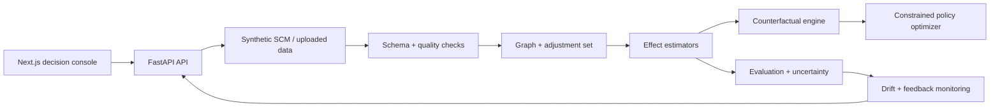

<div align="center">

# QUARRY

### Causal decision intelligence for **interventions you can defend**.

[](https://www.python.org/)
[](https://fastapi.tiangolo.com/)
[](https://nextjs.org/)
[](https://www.typescriptlang.org/)
[](https://docs.docker.com/compose/)
[](https://pytest.org/)

**QUARRY asks the harder question:**  
_What is likely to happen if we change something?_

**Created by [Yogesh R Mehta](https://github.com/Yog-esh06).**

[Features](#-features) · [Architecture](#-architecture) · [Quick start](#-quick-start) · [API](#-api) · [Methodology](#-causal-methodology)

</div>

---

QUARRY is a local-first causal decision intelligence platform for treatment-effect
estimation, counterfactual reasoning, heterogeneous effects, constrained policy
optimization, and ML observability.

It deliberately separates:

- **Prediction:** what outcome is likely?
- **Causal effect:** how would that outcome change under an intervention?

The included lending scenario is a **controlled synthetic structural causal model**.
That makes the demo reproducible, gives evaluation access to hidden ground truth, and
avoids presenting a convenient correlation as a proven causal claim.

> **Causal conclusions are conditional.** QUARRY exposes the configured DAG,
> adjustment set, overlap requirements, and uncertainty instead of hiding them.

## ✦ Features

| Area | What QUARRY provides |
|---|---|
| **Causal graph** | An explicit, inspectable DAG with treatment, outcome, parents, children, and assumptions |
| **Synthetic SCM** | Confounding, heterogeneous effects, missingness, imbalance, temporal faults, and known evaluation truth |
| **Causal ML** | Propensity modeling, IPW, outcome regression, doubly robust estimation, and treatment-effect metrics |
| **Counterfactuals** | Potential outcomes, individual treatment effects, uncertainty intervals, and evidence context |
| **Policy lab** | Cost-aware intervention allocation with resource and risk constraints |
| **Observability** | Feature, treatment, outcome, mechanism, and sequential drift analysis |
| **Production boundary** | FastAPI endpoints, schema contracts, Docker health checks, and a typed Next.js console |
| **Assumption awareness** | Consistency, positivity, and exchangeability are documented as assumptions—not facts |

## ✦ Architecture



### Core flow

1. Generate or ingest a dataset.
2. Validate schema, missingness, treatment balance, and leakage risks.
3. Configure and inspect the assumed causal graph.
4. Estimate treatment effects with a declared adjustment strategy.
5. Compare counterfactual outcomes and uncertainty.
6. Optimize a policy under cost, capacity, and risk constraints.
7. Monitor drift and feed validated outcomes back into evaluation.

## ✦ Quick start

### Local development

```powershell
.\.venv\Scripts\python.exe -m pip install -e ".[dev]"
.\.venv\Scripts\python.exe -m uvicorn app.main:app --app-dir backend --reload
```

In another terminal:

```powershell
Set-Location frontend
npm install
npm run dev
```

Open **http://localhost:3000** for the console and
**http://localhost:8000/docs** for the live API documentation.

### Docker Compose

```powershell
docker compose up --build
```

The same stack is then available on ports `3000` and `8000`. No API keys or GPU
are required for the local demo.

## ✦ API

| Method | Endpoint | Purpose |
|---|---|---|
| `GET` | `/health` | Service health and version |
| `GET` | `/api/v1/causal/graph` | Configured DAG, edges, and graph metadata |
| `GET` | `/api/v1/schema` | Synthetic dataset feature contract |
| `GET` | `/api/v1/datasets/demo/summary` | Reproducible dataset summary |
| `POST` | `/api/v1/datasets/demo/sample` | Generate a bounded preview from the SCM |
| `GET` | `/api/v1/assumptions` | Treatment, outcome, adjustment set, and identification assumptions |
| `GET` | `/api/v1/causal/edges/{node}` | Parent and child relationships for a graph node |

Example:

```powershell
Invoke-RestMethod http://localhost:8000/api/v1/datasets/demo/summary
Invoke-RestMethod http://localhost:8000/api/v1/causal/graph
```

## ✦ Causal methodology

The demo's structural causal model generates a lending population with regional
and channel confounding. Treatment is represented by acquisition channel and the
outcome is default within twelve months. The generator includes mechanisms where
population mix, observed data quality, or the outcome mechanism can change.

The implementation treats these as non-negotiable identification questions:

- Are all relevant common causes measured and adjusted for?
- Is every treatment arm available for comparable units (**positivity**)?
- Does the observed treatment correspond to the intervention being evaluated
  (**consistency**)?
- Are estimates reported with uncertainty and overlap diagnostics?

Ground truth is used only for evaluation, never as a training feature.

## ✦ Quality gates

| Check | Command | Status |
|---|---|---|
| Python syntax | `.\.venv\Scripts\python.exe -m compileall -q backend` | Run before release |
| Backend tests | `.\.venv\Scripts\python.exe -m pytest backend/tests -q` | Run before release |
| Frontend types | `Set-Location frontend; npm run typecheck` | Run before release |
| Frontend build | `Set-Location frontend; npm run build` | Run before release |
| Container health | `docker compose up --build` | Optional local gate |

## ✦ Configuration

Copy `.env.example` to `.env` when environment configuration is needed:

| Variable | Default | Purpose |
|---|---|---|
| `QUARRY_ENV` | `development` | Runtime environment label |
| `QUARRY_API_HOST` | `0.0.0.0` | API bind address |
| `QUARRY_API_PORT` | `8000` | API port |
| `NEXT_PUBLIC_API_URL` | `http://localhost:8000` | Browser API base URL |

## ✦ Project structure

```text
backend/app/main.py             FastAPI boundary and demo endpoints
backend/app/ml/causal/          DAGs, discovery, and mechanism attribution
backend/app/ml/data/             Schema contracts and validation
backend/app/ml/drift/            Drift and distribution diagnostics
backend/app/ml/evaluation/       Evaluation metrics
backend/app/ml/models/           Calibration, ensembles, and model zoo
backend/app/ml/simulation/       Reproducible structural causal model
frontend/app/                    Next.js decision console
deployment/docker/               CPU-oriented container definitions
```

## ✦ Limitations

The current local release is intentionally transparent rather than pretending to
be an enterprise deployment. The demo API uses an in-memory reproducible dataset;
authentication, durable database persistence, and distributed workers are deployment
extensions rather than hidden claims. Replace the synthetic SCM with domain-reviewed
data and a validated DAG before using QUARRY for consequential decisions.

## ✦ Author

**Yogesh R Mehta** — creator and maintainer of QUARRY.  
GitHub: [@Yog-esh06](https://github.com/Yog-esh06)

## License

MIT. See [pyproject.toml](pyproject.toml) for package metadata.
